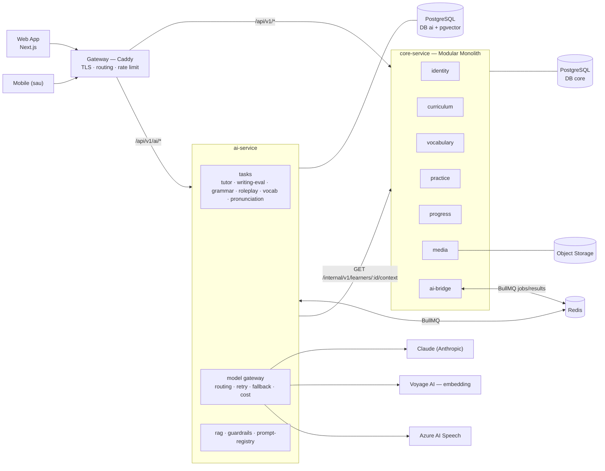
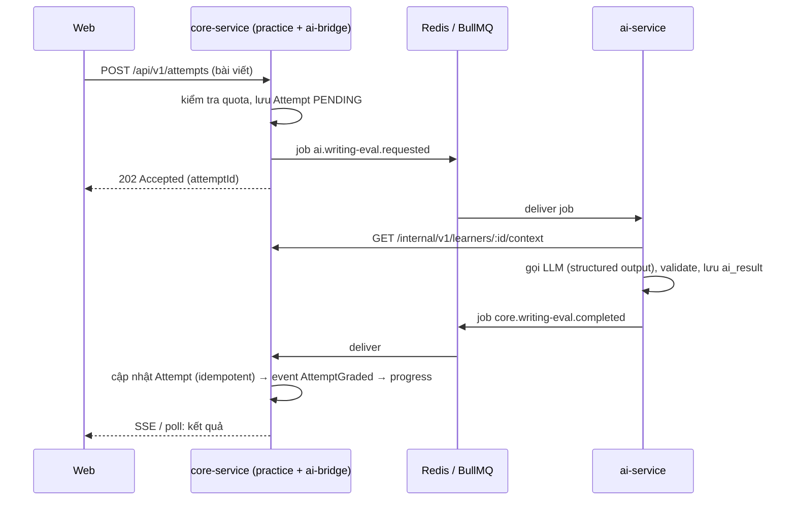

# Tổng quan kiến trúc

> Phương án đã chọn: **Hybrid**, gồm Modular Monolith (`core-service`) và AI service tách riêng (`ai-service`).
> Quyết định: [ADR-0001](../adr/0001-hybrid-architecture.md) · Cập nhật: 2026-11-21

## 1. Thành phần

| Thành phần | Vai trò | Sở hữu dữ liệu |
|---|---|---|
| `apps/web` | Giao diện người học và admin | Không có (chỉ cache phía client) |
| `infra/gateway` (Caddy) | TLS, định tuyến, rate limit thô | Không có |
| `services/core-service` | Toàn bộ nghiệp vụ học tập, auth, nội dung | DB `core`: users, courses, lessons, exercises, attempts, progress, lexemes… |
| `services/ai-service` | Toàn bộ tính năng AI | DB `ai`: conversations, ai_results, usage/cost, embeddings (pgvector) |
| Redis | Cache, rate limit, hàng đợi BullMQ giữa các service | Dữ liệu tạm thời |
| Object storage | Audio, ảnh, bản ghi giọng nói | File |

Lúc đầu hai DB `core` và `ai` nằm trên **cùng một PostgreSQL instance** để tiết kiệm chi phí, nhưng là hai database riêng biệt. Không service nào truy cập DB của service khác.

## 2. Sơ đồ

## 3. Giao tiếp giữa các service

Chi tiết: [ADR-0004](../adr/0004-inter-service-communication.md).

| Kiểu | Hướng | Dùng cho |
|---|---|---|
| **Bất đồng bộ** (BullMQ trên Redis) | core → ai → core | Chấm bài viết, chấm phát âm, tạo embedding, sinh nội dung hàng loạt |
| **Đồng bộ nội bộ** (`/internal/v1`, service token) | ai → core | Lấy ngữ cảnh người học (level, bài đang học, kỹ năng yếu) |
| **Public qua gateway** (`/api/v1/ai/*`, JWT) | web → ai | AI Tutor, hội thoại (streaming SSE) |

**Nguyên tắc quan trọng:** `core-service` **không gọi đồng bộ** sang `ai-service` trong luồng học chính. Nếu AI gặp sự cố, người học vẫn học, làm bài và ôn từ bình thường. Chỉ các tính năng AI bị tạm dừng hoặc xếp hàng chờ.

### Luồng mẫu: chấm bài viết

## 4. Xác thực

- `identity` (trong core) phát hành **JWT ký RS256** và công bố public key qua JWKS.
- `ai-service` tự xác thực JWT bằng JWKS, không cần gọi core cho mỗi request.
- Gọi nội bộ (`/internal/v1`) dùng service token riêng và không được expose qua gateway.

## 5. Nguyên tắc chính

1. **CEFR level là dữ liệu, không phải cấu trúc code.** Không có module hay component riêng cho từng level.
2. **Reading, Listening, Writing, Speaking là `skill` và `exerciseType`**, không phải module riêng.
3. Module trong core chỉ giao tiếp qua public API (`index.ts`) hoặc event. Quy tắc chi tiết: [services/core-service/src/modules/README.md](../../services/core-service/src/modules/README.md).
4. Code nghiệp vụ gọi AI **theo tên task**, không gọi SDK của provider. Model được chọn trong config. Chi tiết: [ADR-0003](../adr/0003-ai-service-boundary.md).
5. Bài tập đóng (trắc nghiệm, điền từ) được **chấm bằng code**, không dùng LLM.

## 6. Khi nào tách thêm service

Chỉ tách khi có dấu hiệu đo được. Xem [ADR-0001 § Điều kiện tách tiếp](../adr/0001-hybrid-architecture.md#điều-kiện-tách-thêm-service).

## Roadmap

| Phase | Mục tiêu | Điều kiện hoàn thành |
|---|---|---|
| 1. Foundation | Monorepo, tooling, docker-compose, khung 2 service + web, CI | Thành viên mới chạy được toàn bộ stack bằng 1–2 lệnh; CI xanh |
| 2. Core BE/FE | `identity`, `curriculum` (đọc), api-client, auth flow, lesson player phiên bản đọc | Đăng nhập và đọc được bài học A1 lấy từ DB |
| 3. LMS | Import `content/`, `practice`, `vocabulary` + SRS, `progress`, `media`, nội dung A1 | Vòng học hoàn chỉnh "học → luyện → ôn → thấy tiến độ" cho A1 |
| 4. AI | `ai-service` (provider, gateway, prompt, eval), `ai-bridge`; writing-eval → grammar → tutor → vocab → roleplay | Mỗi tính năng AI vượt ngưỡng eval và có giới hạn chi phí |
| 5. Hardening | E2E, bảo mật, cache/CDN, deploy production, backup, monitoring | Chạy production ổn định, đã diễn tập khôi phục backup |
