# A1 Learning Roadmap – Lộ trình học A1

> Dữ liệu máy đọc được: [`content/a1/course.yaml`](../../../content/a1/course.yaml). Cập nhật: 2026-11-21.

## 1. Tổng thể

```mermaid
flowchart LR
  E["Einstieg<br/>4 bài · ~3,5 h"] --> K1["K1 Guten Tag!"] --> K2["K2 Freunde, Kollegen und ich"] --> K3["K3 In Hamburg"] --> P1{{"Plattform 1"}}
  P1 --> K4["K4 Guten Appetit!"] --> K5["K5 Alltag und Familie"] --> K6["K6 Zeit mit Freunden"] --> P2{{"Plattform 2"}}
  P2 --> K7["K7 Arbeitsalltag"] --> K8["K8 Fit und gesund"] --> K9["K9 Meine Wohnung"] --> P3{{"Plattform 3"}}
  P3 --> K10["K10 Studium und Beruf"] --> K11["K11 Die Jacke gefällt mir!"] --> K12["K12 Ab in den Urlaub!"] --> P4{{"Plattform 4"}}
  P4 --> F[["Abschlusstest A1"]]
```



| Khối | Nội dung | Kết quả mong đợi (tóm tắt) |
|---|---|---|
| **Einstieg** (bổ sung) | Chữ cái, Umlaut, ß · quy tắc đọc, IPA · trọng âm, ngữ điệu, đề bài tiếng Đức · câu sống còn, 5 đặc điểm của câu | Đọc được chữ viết tiếng Đức, chào/cảm ơn/xin lỗi, báo không hiểu |
| **Khối 1** – K1–3 + Plattform 1 | Làm quen, thông tin cá nhân, sở thích, nghề, số, thành phố, đường đi | Giới thiệu bản thân, hỏi – đáp thông tin cá nhân, hỏi đường đơn giản |
| **Khối 2** – K4–6 + Plattform 2 | Ăn uống, mua sắm, giờ giấc, gia đình, hẹn gặp, rủ đi chơi, nhà hàng | Mua bán, hẹn giờ, mời và nhận lời mời, gọi món |
| **Khối 3** – K7–9 + Plattform 3 | Công việc, sức khỏe, nhà ở | Nói về ngày làm việc, đi khám bệnh, mô tả căn hộ |
| **Khối 4** – K10–12 + Plattform 4 | Học tập/nghề nghiệp, quần áo, du lịch, thời tiết | Kể đơn giản việc đã làm (Perfekt), mua quần áo, kể chuyến đi |
| **Abschlusstest A1** | Nghe, đọc, viết, nói + từ vựng/ngữ pháp | Đạt chuẩn A1 theo tiêu chí ở [a1-assessment-spec.md](a1-assessment-spec.md) |

## 2. Cấu trúc bên trong một Kapitel

```
Kapitel N
├── Bài 1 … Bài 5 (theo các mục của giáo trình)
│     Mỗi bài: Tổng quan → Từ vựng → Ngữ pháp → Redemittel → Phát âm → Ví dụ
│              → Nghe → Đọc → Nói → Viết → Bài tập → Tóm tắt → Tự kiểm tra
└── Kurz und klar – Test (tổng kết + kiểm tra 4 kỹ năng)
```

Chi tiết từng thành phần: [a1-lesson-content-spec.md](a1-lesson-content-spec.md).

## 3. Thời lượng ước tính (tự học)

| Phần | Ước tính | Cơ sở |
|---|---|---|
| Einstieg | ~3,5 giờ | Tổng `estimated_minutes` của 4 bài (220 phút) |
| Mỗi Kapitel | ~7–9 giờ | Kapitel 1 thực tế: 435 phút. Giáo trình: ~10 UE (7,5 giờ trên lớp) + bài tập về nhà |
| Mỗi Plattform | ~3–4 giờ | Giáo trình: 4–5 UE KB + 2–3 UE ÜB |
| Ôn từ vựng SRS | ~10–15 phút/ngày | Liên tục suốt khóa |
| Abschlusstest | ~2,5 giờ | Theo cấu trúc đề A1 |
| **Tổng A1** | **khoảng 110–140 giờ** | Ước tính; sẽ hiệu chỉnh khi có dữ liệu học thật |

Với **45–60 phút/ngày, 6 ngày/tuần**: khoảng **5–6 tháng**.

## 4. Điều kiện mở khóa (gating)

| Muốn mở | Điều kiện |
|---|---|
| Kapitel 1 | Hoàn thành 4 bài Einstieg (có thể bỏ qua bằng bài kiểm tra đầu vào – đề xuất, chưa triển khai) |
| Bài tiếp theo trong Kapitel | Bài trước đạt điều kiện hoàn thành bài (xem assessment spec §3) |
| Kapitel tiếp theo | Kurz und klar – Test của Kapitel trước: **mỗi kỹ năng ≥ 60%** (không chỉ điểm trung bình). Nếu chưa đạt: hệ thống đề xuất bài cần ôn, cho phép học tiếp nhưng gắn cờ „cần ôn“ |
| Plattform | Hoàn thành 3 Kapitel của khối |
| Abschlusstest A1 | Hoàn thành 4 Plattform; không còn mục tiêu nào ở trạng thái „yếu“ quá 14 ngày |

## 5. Kế hoạch học mẫu (1 tuần ≈ 1 Kapitel)

| Ngày | Việc |
|---|---|
| Thứ 2 | Bài 1 (60 phút) |
| Thứ 3 | Bài 2 (60–70 phút) |
| Thứ 4 | Bài 3 (chia 2 buổi nếu cần) |
| Thứ 5 | Bài 4 |
| Thứ 6 | Bài 5 + ôn từ vựng |
| Thứ 7 | Kurz und klar – Test; ôn phần yếu |
| Chủ nhật | Nghỉ hoặc chỉ ôn SRS 10 phút |

Hướng dẫn chi tiết cho người học: [a1-self-study-guide.md](a1-self-study-guide.md).

## 6. Trạng thái triển khai

| ID | Phần | Trạng thái |
|---|---|---|
| a1-u00 | Einstieg | ✅ ready |
| a1-k01 | Kapitel 1 – Guten Tag! | ✅ ready |
| a1-k02 | Kapitel 2 – Freunde, Kollegen und ich | ✅ ready |
| a1-k03 | Kapitel 3 – In Hamburg | ✅ ready |
| a1-p1 | Plattform 1 | ✅ ready |
| a1-k04 … a1-k12 | Kapitel 4–12 | ⏳ planned |
| a1-p2 … a1-p4 | Plattform 2–4 | ⏳ planned |

**Khối 1 (Einstieg + Kapitel 1–3 + Plattform 1) đã hoàn chỉnh.** Thời lượng thực tế: Einstieg 220 phút, Kapitel 1 435 phút, Kapitel 2 520 phút, Kapitel 3 485 phút, Plattform 1 240 phút – tổng khoảng 32 giờ.
| a1-final | Abschlusstest A1 | ⏳ planned (đã có đặc tả) |
